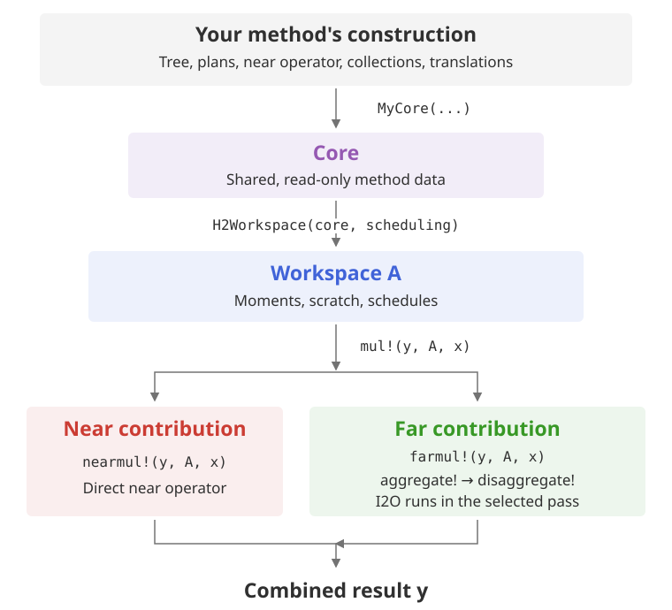
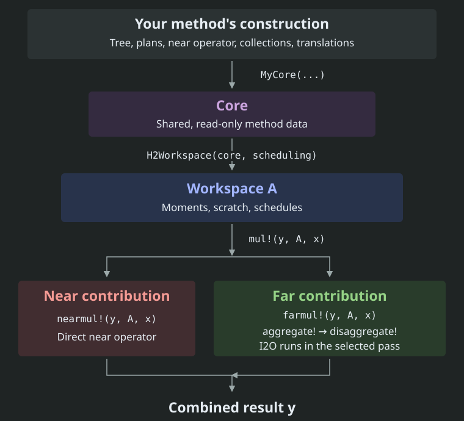

# Construction and execution

Construction computes the data describing a fast method. Execution reuses
that data for different input vectors. A workspace connects the two.

```@raw html
<figure class="theme-diagram">
<div class="diagram-light">
```



```@raw html
</div>
<div class="diagram-dark">
```



```@raw html
</div>
</figure>
```

The two bottom branches show contributions to the product, not a requirement
to execute them concurrently. I2O can run in either tree pass, according to
the chosen traversal mode.

## Construct the core once

Your constructor builds the tree, plans, near operator, leaf collections,
and translations. `H2Factory.assembleplans(tree, interactionstrategy)` can
build the plans, but there is no universal constructor that derives all
numerical data for an arbitrary fast method.

Store the read-only results in your core. See [Required methods](implementing/required.md)
for the accessors that expose them.

## Allocate a workspace

`H2Factory.H2Workspace(core, scheduling)` first constructs chunk schedules.
It then calls `buildmoments`, `buildvectorbuffers`, `buildi2ichannels`,
`buildo2ochannels`, `buildi2ochannel`, and `buildleafchannels` on H2Factory's
generics. Those calls create the workspace's mutable storage.

`H2Factory.similarworkspace(A)` repeats allocation over the same core. It
does not recompute the near operator, leaf collections, or translations.

## Multiply repeatedly

`mul!(y, A, x)` reads core data and changes workspace buffers. The near
operator acts directly on x; the far product forms moments and runs the
tree passes. Their results are combined in y.

Separate workspaces can share one core for concurrent products. A transpose
or adjoint view of A still uses A's existing buffers. See
[Core and workspace](maps/core-workspace.md) for the ownership rules and
[How the multiplication works](algorithm.md) for the tree operations.
