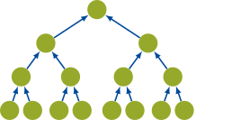
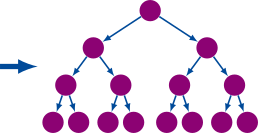

# Aggregation and disaggregation

Plans describe the node visits. Schedules split them into chunks. Traversal
then calls the method's leaf operations, transfers, modulation, and couplings.
These are separate responsibilities.

## Upward: aggregation

`H2Factory.aggregate!(A, x)` gathers leaf coefficients from x and forms source
moments. For an internal node, it transfers and adds its children's moments.
The plan determines which moments must remain stored for later reads.

The first contribution overwrites its destination; later contributions
accumulate. A custom transfer must preserve both modes.

## Downward: disaggregation

`H2Factory.disaggregate!(y, A)` propagates received expansions towards the
leaves and projects them into y. In the default mode it also applies I2O
from well-separated source nodes.

`H2Factory.farmul!(y, A, x)` orchestrates both passes. Call it for a complete
far product rather than manually composing phases without their initialization
and storage rules.

## Two placements of I2O

| H2Trees mode | Upward | Downward |
| :--- | :--- | :--- |
| `AggregateMode()` | Aggregate | Translate and disaggregate |
| `AggregateTranslateMode()` | Aggregate and translate | Disaggregate |

H2Trees builds the corresponding forward and transposed plans. Expose all
four side-specific plans on the core. `H2Factory.farmulmode(core,
H2Factory.isForward())` must agree with their construction.

The [H2Trees plans guide](https://djukic14.github.io/H2Trees.jl/dev/plans/plans/)
explains plan generation. Here the important contract is execution: moments
read later must persist, scratch follows the chunk's level, and orientation
selects the right side. Custom traversal hooks must preserve those properties.
