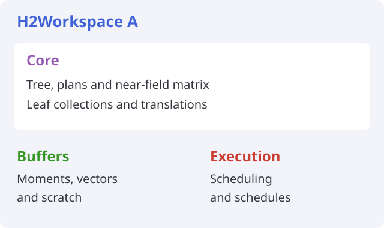
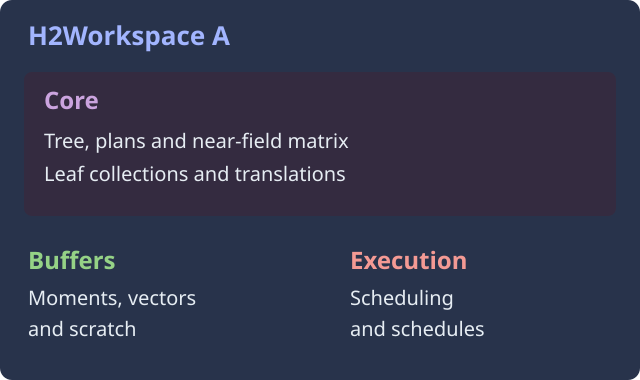

# Core and workspace

The core holds data that multiplication reads. A workspace holds the mutable
data needed to execute it. The workspace, not the core, is passed to `mul!`.

```@raw html
<figure class="theme-diagram core-workspace-diagram">
<div class="diagram-light">
```



```@raw html
</div>
<div class="diagram-dark">
```



```@raw html
</div>
</figure>
```

| Core: shared | Workspace: private |
| :--- | :--- |
| Tree and interaction plans | Moments and backing pools |
| Leaf collections | Leaf vector buffers |
| Near matrix | Translation and leaf scratch |
| Level transfers and I2O coupling | Schedules and execution settings |

H2Factory treats the core as read-only during multiplication. This is a
contract for implementations, not a deep immutability guarantee from Julia.

The [construction-to-execution diagram](../construction.md) shows when these
objects are built and which calls reuse them.

## Construct an executable map

Define a subtype of `H2Factory.GalerkinH2Core{T}` or
`H2Factory.PetrovGalerkinH2Core{T}`. `T` is the map's element type. Galerkin
cores use the same space and tree on both sides; Petrov cores can use different
spaces or trees.

Once your core implements the [required methods](../implementing/required.md):

```julia
using H2Factory, LinearAlgebra
using OhMyThreads: SerialScheduler

A = H2Factory.H2Workspace(core, SerialScheduler(); nchunks=1)
mul!(y, A, x)
```

Here `core` is your constructed core, and `x` and `y` have the map's input
and output lengths. See the [worked example](../implementing/example.md)
for a concrete definition.

## Share the core, not scratch

`H2Factory.similarworkspace(A)` allocates new mutable storage over the same
core. The workspaces can then multiply independently.

`transpose(A)` and `adjoint(A)` share A's scratch. They cannot run at the same
time as A. An overlapping operation on one workspace raises
`H2Factory.ConcurrentWorkspaceError`.

Workspace construction calls your builders after its chunk schedules exist.
Those builders return fresh mutable data, not cached buffers from the core.
See [allocation](../moments/allocation.md) and [scheduling](scheduling.md).
